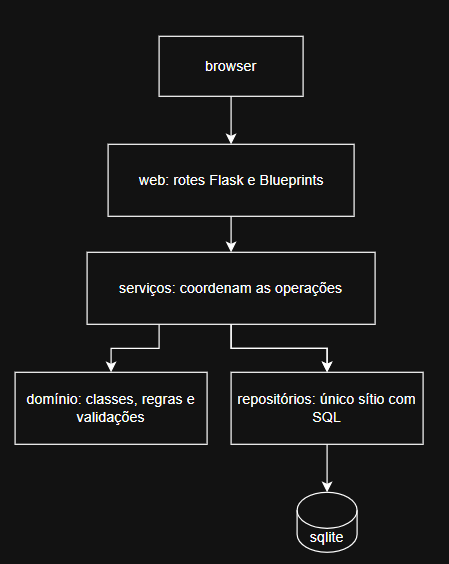
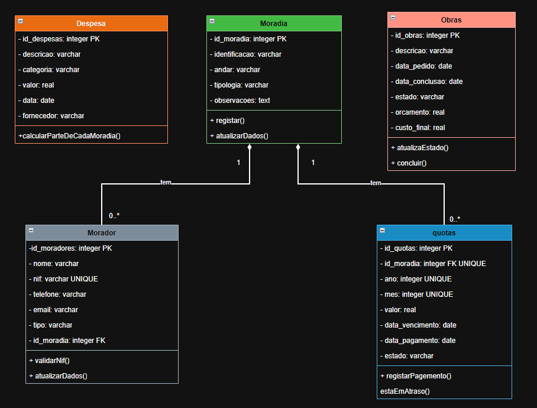

# Arquitetura de rdCondomínios

A aplicação está organizada em camadas. Cada camada tem uma responsabilidade e só 
fala com a camada logo abaixo.

| Camada | Pasta | Responsabilidade |
|---|---|---|
| web | `src/rd_condominios/web/` | Recebe os pedidos, lê os formulários, escolhe o template, mostra mensagens (`flash`) e faz `redirect`. Não tem SQL nem regras de negócio. |
| serviços | `src/rd_condominios/servicos/` | Coordenam cada operação: constroem o objeto de domínio (onde se valida) e chamam o repositório. |
| domínio | `src/rd_condominios/dominio/` | Classes (`@dataclass(frozen=True)`), regras e validações, e as exceções próprias. Não conhece a base de dados nem o Flask. |
| repositórios | `src/rd_condominios/repositorios/` | Único sítio com SQL. Consultas parametrizadas (`?`). Traduz erros da base de dados em exceções do domínio. |
| templates | `src/rd_condominios/templates/` | Páginas HTML (Jinja2). Só apresentam os dados. |

## Ficheiros de apoio

- `app.py`: função `criar_app()`. Define a `secret_key`, cria as tabelas com `inicializar` e regista os Blueprints.
- `config.py`: `obter_caminho_bd()`. Lê a variável `RD_CONDOMINIOS_BD` ou usa `data/condominio.db`.
- `base_dados.py`: `ligar()` abre a ligação (com `foreign_keys` ligadas e `Row` como resultado) e `inicializar()` cria as tabelas.

## Entidades

| Entidade | Classe | Regras principais |
|---|---|---|
| Moradia | `Moradia` | Identificação obrigatória e única. Não se apaga se tiver moradores ou quotas. |
| Morador | `Morador` | NIF com 9 algarismos e único. Data de saída não anterior à entrada. |
| Quota | `Quota` | Mês de 1 a 12. Única por moradia, ano e mês. Estado calculado. |
| Despesa | `Despesa` | Descrição obrigatória, categoria válida. Parte por moradia calculada. |
| Obra | `Obra` | Estado pendente, em curso ou concluída. Concluída exige data de conclusão. |

## Modelos de dados

`despesas` e `obras` são independentes das outras tabelas. A restrição
`UNIQUE (id_moradia, ano, mes)` impede quotas repetidas.

## Exemplo de: registar uma moradia

1. O utilizador preenche o formulário e envia (`POST /moradias/`).
2. A rota em `web/moradias.py` lê os campos e abre a ligação à base de dados.
3. A rota chama `MoradiaServico.criar_moradia(...)`.
4. O serviço constrói um objeto `Moradia`. O `__post_init__` remove espaços e valida (identificação não vazia, até 100 caracteres). Se falhar, sai `DadosMoradiaInvalidos`.
5. O serviço chama `MoradiaRepositorio.guardar(...)`, que faz o `INSERT` parametrizado dentro de `with self.ligacao:` (confirma que guardou).
6. Se a identificação já existir, o SQLite levanta `IntegrityError` e o repositório traduz para `IdentificacaoDuplicada`.
7. Em caso de erro, a rota mostra o formulário com a mensagem e os dados escritos. Em caso de sucesso, faz `flash` verde e `redirect` para a lista.
8. A ligação é sempre fechada no `finally`.

## Decisões técnicas

- **Camadas separadas:** facilitam testar e alterar uma parte sem mexer nas outras. Os testes usam serviços e repositórios sem precisar do Flask.
- **Flask em vez de FastAPI:** a aplicação gera páginas HTML com formulários, e o Flask com Jinja2 serve esse caso de forma simples.
- **SQLite:** ficheiro único, sem servidor, adequado a uso pessoal e local.
- **Estado da quota calculado:** não se guarda, calcula-se pelas datas. Evita contradições entre estado e data de pagamento.
- **Histórico de moradores:** `data_entrada` e `data_saida`. Quem sai não se apaga. As quotas ligam-se à moradia, por isso o histórico financeiro não se perde.
- **Despesas e obras independentes:** os gastos de obras ficam só no `custo_final` da obra, para não contar o mesmo gasto duas vezes.
- **Divisão igual das despesas:** calculada na listagem, não guardada.
- **Validação em duas camadas:** no browser (`required`, `maxlength`) e no servidor (domínio), mais as restrições da base de dados (`NOT NULL`, `UNIQUE`, chave estrangeira).
- **Application factory e Blueprints:** `criar_app()` cria a aplicação e cada entidade tem o seu Blueprint.

## Evolução futura

- Entidade `Condominio` para suportar vários condomínios (`UNIQUE (id_condominio, identificacao)`).
- Tabela de ocupações, para a mesma pessoa poder sair e voltar a entrar.
- Autenticação
- Migrações da base de dados.